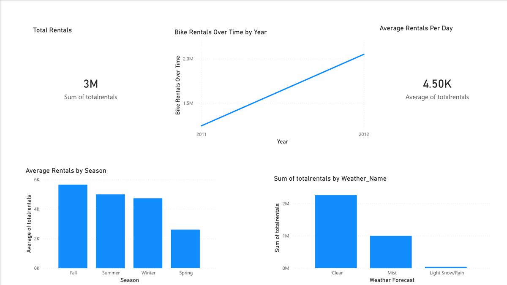

**Bike Sharing Data Analysis Report**

**1. Introduction**

This project analyzes a bike sharing dataset to understand the key factors that influence bike rental demand. The main objective is to explore how variables such as season, weather conditions, and time impact the number of rentals. By identifying patterns and trends in the data, this project aims to provide insights that can support better decision-making for bike-sharing services.

The intended audience for this analysis includes city planners, transportation managers, and business analysts who are interested in optimizing bike-sharing operations. These users require clear and simple insights that highlight trends in usage rather than complex technical outputs.

**2. Dataset Description**

The dataset used in this project contains daily records of bike rentals along with several related variables. These include both numerical and categorical attributes such as temperature, humidity, wind speed, season, and weather conditions. The dataset meets the assignment requirements as it contains more than five attributes and includes a mix of data types.

During the initial exploration, the dataset was inspected using basic functions to understand its structure and content. The data was found to be well-organized, with no major missing values affecting the analysis. Some variables were renamed for clarity, and categorical variables such as season and weather were transformed into more readable labels to improve interpretation.

**3. Data Analysis and KPIs**

The analysis began by calculating key performance indicators (KPIs) to summarize overall rental activity. These included the total number of rentals, the average number of rentals per day, and the maximum and minimum rental values. These KPIs provide a quick overview of system usage and establish a baseline for further analysis.

Further exploration involved grouping the data by season and weather conditions to identify differences in rental behavior. The results showed that bike rentals are significantly higher during warmer seasons such as summer and fall, while colder seasons have lower usage. Similarly, clear weather conditions are associated with higher rental counts, while poor weather reduces demand.

A time-based analysis was also conducted using a line chart, which revealed fluctuations in rental activity over time. The data showed noticeable peaks during certain periods, indicating higher demand during specific seasons. Additionally, a positive relationship between temperature and rental counts was observed, suggesting that higher temperatures encourage more bike usage.

A time-based visualization was created to observe how bike rental demand changes over time. This helps identify patterns, trends, and periods of peak usage.

Comparative bar charts were used to clearly illustrate differences in average rental demand across seasons and weather conditions.

A scatter plot was used to examine the relationship between temperature and bike rentals, providing insight into how environmental factors influence demand. 

A correlation matrix was generated to analyze the relationships between numerical variables and identify which factors are most strongly associated with rental activity. 

**4. Dashboard and Visualizations**

A dashboard was created using Power BI to present the findings in a clear and interactive way.

The dashboard includes key performance indicators and multiple visualizations to support comparative analysis.

The KPI cards display the total number of rentals and the average rentals per day, providing a quick summary of system usage. The line chart illustrates rental trends over time, highlighting patterns and fluctuations in demand.

The bar chart comparing seasons shows that average rentals are highest during summer and fall, confirming the strong seasonal influence on bike usage. Another bar chart compares weather conditions, demonstrating that clear weather leads to significantly higher rental activity compared to mist or rainy conditions.

These visualizations make it easy to identify patterns and support data-driven decision-making.

**5. Data Story and Insights**

The analysis reveals that bike rental demand is strongly influenced by both seasonal and environmental factors. Warmer temperatures and favorable weather conditions lead to increased usage, while colder seasons and poor weather reduce demand.

From a practical perspective, these insights can help city planners and bike-sharing operators better allocate resources, plan maintenance schedules, and optimize bike availability. For example, more bikes can be deployed during peak seasons, while fewer resources may be needed during periods of low demand.

Overall, the project demonstrates how data can be used to uncover meaningful patterns and support informed decision-making in real-world scenarios.

**6. Conclusion**

In conclusion, this project successfully analyzed a bike sharing dataset to identify key factors influencing rental demand. Using KPIs, data visualization, and comparative analysis, clear patterns were identified that highlight the importance of seasonality and weather conditions.

The use of Power BI allowed these insights to be presented in a visually effective way, making the findings accessible and easy to interpret. This project demonstrates the value of combining data analysis with visualization tools to create impactful data-driven stories.
