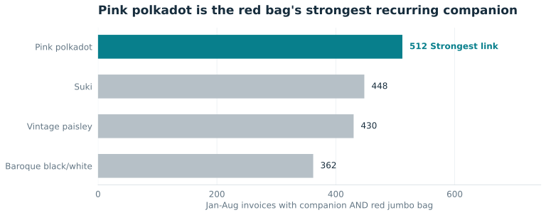

# RetailFlow

A Durham College Data Visualization group project by Mohamed Barakat, Ahmed Barakat, Hasan Syed and Hoang Anh Nguyen. Mohamed led the story and contributed the product-pair ranking and attachment analysis.

The team used historical UK purchase invoices to identify five frequently co-ordered jumbo bags. Across the retained period, 1,564 UK invoices contained at least two of the five. The team proposed a two-week trial of a shared warehouse picking zone, with pick time and accuracy measured against the current arrangement. The historical dataset contains orders and does not measure warehouse picking time.

[Coursework report](Coursework-Report.txt)



## Reproduce the analysis

Download `Online Retail.xlsx` from the [UCI Online Retail dataset](https://doi.org/10.24432/C5BW33). Place it in `data/raw/` under this project folder, then run:

```bash
python -m pip install -r code/requirements.txt
python code/analysis.py
```
